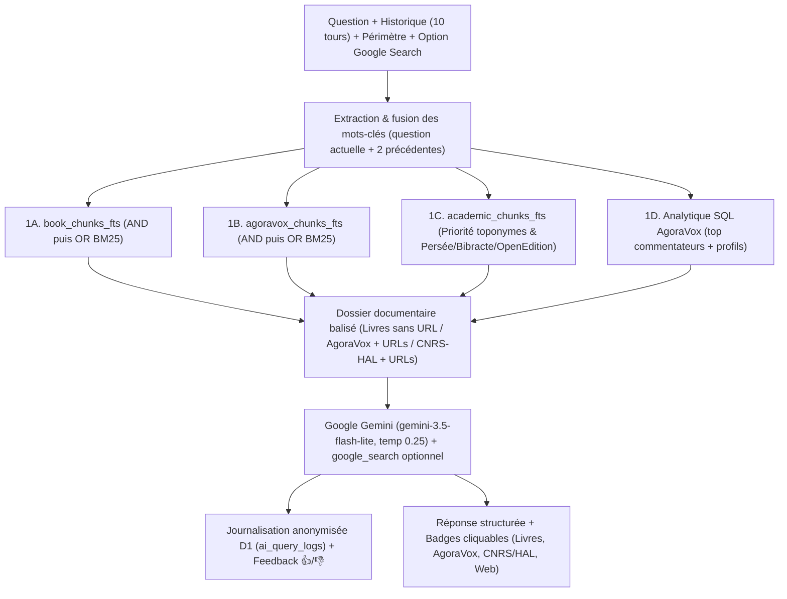

# Rapport d'Audit — Base Documentaire Cloudflare D1, Assistant IA & Feuille de Route

> **Version** : 2.0 — Mis à jour le **21 novembre 2026**  
> **Dépôt GitHub** : [`pmourey/Livres-de-Jean`](https://github.com/pmourey/Livres-de-Jean)  
> **Site en ligne** : [https://pmourey.github.io/Livres-de-Jean/](https://pmourey.github.io/Livres-de-Jean/)  
> **Objet** : Inventaire exhaustif des données indexées sur Cloudflare D1 (`livres_de_jean`), statut des améliorations déjà déployées sur l'Assistant IA et le référencement documentaire, et feuille de route (TODOs) pour l'enrichissement continu et la visibilité auprès des modèles publics.

---

## 1. Statut des améliorations déployées (Suivi de réalisation)

| # | Amélioration / Chantier | Statut | Détails techniques & Commit / Version |
| :---: | :--- | :---: | :--- |
| 1 | **Indexation intégrale de 11 volumes PDF d'Émile Mourey (100 % du catalogue)** (`book_chunks` + FTS5) | ✅ **Déployé** | **8 266 passages** avec numéros de pages exacts (`3 370` pages couvertes, incluant *Christ T2*, *Mahomet T2* et *La Gaule en héritage 2e partie*). |
| 2 | **Indexation complète AgoraVox (articles + commentaires + profils auteurs)** | ✅ **Déployé** | **559 articles** (`6 586` segments) + **22 784 commentaires** (`1 377` intervenants) + 120 profils `/auteur/...` cliquables (`2fe596a`). |
| 3 | **Indexation des publications scientifiques officielles** (`academic_chunks` + FTS5) | ✅ **Déployé** | **740 publications** (704 CNRS HAL-SHS, 32 archives universitaires, *Gallia* 55 / Persée, *CRAI*, OpenEdition RACF, Bibracte). Bug SQL (`hal_id`/`pdf_url`) corrigé (`c94d8f0`). |
| 4 | **Fusion du contexte de session sur les questions de suivi** | ✅ **Déployé** | Les questions de suivi réinjectent automatiquement les toponymes/mots-clés des 2 questions précédentes (`ba6c76d`). |
| 5 | **Ouverture automatique du corpus scientifique** | ✅ **Déployé** | Interroge `academic_chunks_fts` dès qu'un lecteur mentionne *fouilles, CNRS, Gallia, HAL, INRAP, thèses, objections ou consensus* (`ba6c76d`). |
| 6 | **Option `Google Search : ON / OFF` à la demande (Search Grounding)** | ✅ **Déployé** | Active nativement `tools: [{ google_search: {} }]` dans Gemini et affiche les sources web en temps réel sous forme de badges cliquables (`c94d8f0`). |
| 7 | **Levier 1 RAG — Journalisation anonymisée & boucle de feedback lecteur** | ✅ **Déployé** | Table D1 `ai_query_logs` (`migrations/0010_create_ai_query_logs.sql`), boutons 👍 Utile / 👎 À enrichir (`POST /api/ai/feedback`) et endpoint admin `GET /api/admin/ai-logs` (`c94d8f0`). |
| 8 | **Historique multi-sessions & partage public en lecture seule** | ✅ **Déployé** | Persistance locale multi-sessions + instantanés partagés D1 (`#/ai/share/:id`). |
| 9 | **Page *Méthode & Controverse* : sources cliquables, extraits & mode nuit** | ✅ **Déployé** | 7 dossiers enrichis avec liens officiels CNRS/Persée/HAL/Gallica, panneaux d'extraits littéraux avec pages, commentaires par dossier et contraste mode nuit corrigé (`ba6c76d`). |
| 10 | **SEO & Référencement (`sitemap.xml` + `robots.txt`)** | ✅ **Déployé** | `public/sitemap.xml` (18 URLs : 6 vues + 12 ouvrages) et `public/robots.txt` publiés sur GitHub Pages (`2e403c6`). |

---

## 2. Diagnostic rétrospectif de la session `em-511b1s5s0z`

Dans la session partagée [`em-511b1s5s0z`](https://pmourey.github.io/Livres-de-Jean/#/ai/share/em-511b1s5s0z), l'Assistant IA avait indiqué qu'aucune publication scientifique ne figurait dans les sources transmises pour **trois raisons cumulées, toutes corrigées depuis** :

1. Le sélecteur **Périmètre** était resté positionné sur `agoravox` (`scope: "agoravox"`), ce qui désactivait la recherche dans `book_chunks_fts` et `academic_chunks_fts`.
2. La question de suivi (*« peux-tu citer les références des publications scientifiques contredisant les thèses d'Emile Mourey ? »*) ne répétait aucun nom de site (`Bibracte`, `Alésia`, `Gergovie`).
3. La requête SQL sur `academic_chunks` référençait deux colonnes absentes du schéma `0008` (`hal_id`, `pdf_url`), ce qui faisait échouer silencieusement la lecture FTS5.

> **État actuel** : ces trois points sont résolus dans `src/worker.ts` (version Cloudflare `5526801e-cb52-4d48-a60d-f9551b018236`, commit `c94d8f0`). Les 740 publications scientifiques remontent désormais normalement, y compris en question de suivi.

---

## 3. Inventaire exhaustif des données indexées dans Cloudflare D1

Base Cloudflare D1 : `livres_de_jean` (`16181fe9-b0a5-4f20-979b-68c745f2c03d`) — taille actuelle : **97,83 Mo** (plafond 5 Go), **38 376 enregistrements textuels** répartis en **3 corpus isolés** dotés chacun d'un index plein texte **SQLite FTS5** (ranking BM25).

| Corpus | Table D1 & Index FTS5 | Volume indexé | Origine exacte |
| :--- | :--- | ---: | :--- |
| **Ouvrages d'Émile Mourey** | `book_chunks` / `book_chunks_fts` | **8 266** passages | 11 volumes PDF originaux extraits page par page (100 % du catalogue) |
| **AgoraVox (Articles & Débats)** | `agoravox_chunks` / `agoravox_chunks_fts` | **29 370** extraits | Archive locale `~/Agoravox` + 89 articles récents collectés sur `agoravox.fr` (`scripts/index-agoravox-to-d1.py`, `scripts/sync-missing-agoravox.py`) |
| **Publications scientifiques & archéologiques** | `academic_chunks` / `academic_chunks_fts` | **740** notices & résumés | API ouverte **CNRS HAL-SHS** (`api.archives-ouvertes.fr`) + synthèses **Persée / *Gallia* 55 / *CRAI* / INRAP / OpenEdition** (`scripts/index-academic-to-d1.py`) |
| **Total indexé** | **3 tables + 3 index FTS5** | **38 376** entrées | — |

### 3.1. Corpus 1 — Ouvrages d'Émile Mourey (`book_chunks` : 8 266 passages — 100 % du catalogue)

| Identifiant (`book_id`) | Ouvrage | Tome | Passages | Pages couvertes |
| :--- | :--- | :--- | ---: | ---: |
| `mourey-gergovie-tome-1` | *Histoire de Gergovie* | Tome 1 | 786 | p. 1 à 413 |
| `mourey-bibracte-tome-2-bouclier-eduen` | *Histoire de Bibracte* | Tome 2 : Le Bouclier Éduen | 1 860 | p. 1 à 392 |
| `mourey-bibracte-tome-3-epee-flamboyante` | *Histoire de Bibracte* | Tome 3 : L'Épée Flamboyante | 818 | p. 1 à 399 |
| `mourey-bibracte-tome-4-dieu-rayonnant` | *Histoire de Bibracte* | Tome 4 : Dieu Rayonnant | 700 | p. 1 à 370 |
| `mourey-bibracte-tome-5-dieu-cache` | *Histoire de Bibracte* | Tome 5 : Dieu Caché | 798 | p. 1 à 406 |
| `mourey-gaule-en-heritage` | *La Gaule en héritage* | 1ère partie | 798 | p. 1 à 302 |
| `mourey-gaule-en-heritage-2` | *La Gaule en héritage* | 2ème partie | 207 | p. 1 à 84 |
| `mourey-christ-tome-1` | *Histoire du Christ* | Tome 1 | 864 | p. 1 à 415 |
| `mourey-christ-tome-2` | *Histoire du Christ* | Tome 2 | 810 | p. 1 à 388 |
| `mourey-mahomet-tome-1` | *Histoire de Mahomet* | Tome 1 | 313 | p. 1 à 101 |
| `mourey-mahomet-tome-2` | *Histoire de Mahomet* | Tome 2 | 312 | p. 1 à 100 |
| **Total** | **11 volumes PDF intégraux (100 % du catalogue)** | — | **8 266** | **3 370 pages** |

### 3.2. Corpus 2 — AgoraVox (`agoravox_chunks` : 29 370 extraits)

| Type (`source_type`) | Extraits | Articles distincts | Auteurs distincts | Liens directs conservés |
| :--- | ---: | ---: | ---: | :--- |
| `article` (Émile Mourey) | **6 586** | **559** | 1 | URL canonique `https://www.agoravox.fr/.../article/...` |
| `comment` (Lecteurs & réponses) | **22 784** | **556** | **1 377** | Ancre exacte `#forum<id>` + profil `/auteur/<slug>` |

### 3.3. Corpus 3 — Publications scientifiques & archéologiques (`academic_chunks` : 740 publications)

* **Origines** : 704 **CNRS HAL / HAL-SHS**, 32 archives universitaires françaises partenaires HAL (`theses.hal.science`, `dumas.ccsd.cnrs.fr`), 2 synthèses **Persée** (*Gallia* 55 & *CRAI*), 1 **OpenEdition** (*RACF* / INRAP), 1 **Centre archéologique européen de Bibracte**.

| Thématique | Articles | Ouvrages / Chapitres | Rapports de fouilles | Thèses / HDR | Total |
| :--- | ---: | ---: | ---: | ---: | ---: |
| **Bibracte & Éduens** | 46 | 44 | 64 | 5 | **159** |
| **Alésia & Siège de 52 av. J.-C.** | 96 | 16 | 6 | 12 | **130** |
| **Origines de l'islam, Coran & Tabari** | 65 | 20 | 0 | 10 | **95** |
| **Esséniens, Qumrân & Judéo-christianisme** | 55 | 17 | 0 | 14 | **86** |
| **Table de Peutinger & Voies romaines** | 50 | 20 | 4 | 11 | **85** |
| **Guerre des Gaules & Légions** | 42 | 32 | 1 | 6 | **81** |
| **Gergovie & Arvernes** | 33 | 13 | 3 | 3 | **52** |
| **Bourgogne antique, Autun & Chalon** | 26 | 7 | 6 | 4 | **43** |
| **Art roman bourguignon (Vézelay, Autun, Chalon)** | 6 | 2 | 0 | 1 | **9** |
| **Total** | **419** | **171** | **84** | **66** | **740** |

---

## 4. Architecture RAG & Usage des données externes

| Source | Rôle actuel |
| :--- | :--- |
| **Cloudflare D1 (RAG littéral)** | Source d'autorité principale (ouvrages, AgoraVox, 740 notices CNRS/HAL/Persée). |
| **Google Search Grounding (`google_search`)** | **Activable à la demande** par le lecteur (`Google Search : ON / OFF`) pour interroger le web public en temps réel en complément de D1. |
| **Connaissances pré-entraînées du LLM** | Volontairement bridées par le prompt système pour interdire toute citation ou URL inventée ; servent uniquement à la compréhension linguistique et à la rédaction structurée. |

---

## 5. Feuille de route (TODOs) — Enrichissement du RAG & Visibilité auprès des modèles publics (GEO / AI Search)

Pour que les **thèses, ouvrages et références documentaires d'Émile Mourey** soient mieux connus, correctement attribués et cités sans distorsion par les **modèles publics d'IA** (Google AI Overviews / Gemini, ChatGPT Search, Perplexity, Claude) **et** pour continuer à améliorer l'Assistant IA du site :

### A. Enrichissement du corpus interne (RAG Cloudflare)
- [x] **Ingérer les 3 PDF manquants dans `book_chunks`** *(Déployé — +1 329 passages : Christ T2 810, Mahomet T2 312, La Gaule en héritage 2e partie 207 → total 8 266 passages / 100 % du catalogue)*.
- [x] **Indexer le texte intégral des conclusions de fouilles HAL-SHS en libre accès** *(Déployé via `scripts/enrich-hal-fulltext.py` — **127 PDF ouverts majeurs** extraits et enrichis en texte intégral sur les 9 thématiques : Bibracte 22, Gergovie 18, Alésia 17, Esséniens/Qumrân 14, Islam/Coran/Tabari 14, Table de Peutinger 13, Bourgogne antique 10, Guerre des Gaules 10, Art roman bourguignon 9 → **780 publications scientifiques** dans `academic_chunks`, base D1 `99,10 Mo`)*.
- [x] **Afficher le tableau de bord `ai_query_logs` dans l'Espace Gestion Auteur** *(Déployé — onglet « Journal IA (RAG) » avec filtres Trous documentaires / À enrichir / Utiles et export JSONL)* : visualiser directement dans `AdminDashboard.tsx` les questions lecteurs, les retours `👎 À enrichir` et les requêtes ayant renvoyé `0` passage livre ou scientifique.
- [ ] **Créer une table `curated_qa` (fiches de référence validées par l'éditeur)** : injecter en priorité des synthèses relues et validées pour les 20–30 questions les plus fréquentes (Bibracte/Beuvray, *altero die*, Gorgobina, Gergovie/Le Crest, Vézelay, Qumrân, Tabari).
- [ ] **Ajouter une recherche hybride vectorielle (Cloudflare Vectorize + Gemini Embeddings)** : compléter FTS5 par une recherche sémantique pour retrouver les bons passages même lorsque le lecteur utilise des synonymes ou des formulations indirectes.

### B. Enrichissement & référencement auprès des modèles d'IA publics (GEO — *Generative Engine Optimization*)
Les grands modèles publics (Google, OpenAI, Anthropic, Perplexity) s'appuient sur le web public indexable, les données structurées et les dépôts ouverts pour apprendre et citer des sources :
- [x] **Publier un fichier `/llms.txt` à la racine du site (`public/llms.txt`)** *(Déployé sur GitHub Pages : `https://pmourey.github.io/Livres-de-Jean/llms.txt`)* : standard émergent lu par les crawlers IA résumant de façon structurée la biographie d'Émile Mourey, la bibliographie complète (12 ouvrages), les 7 dossiers de contre-enquêtes et les liens canoniques vers les ouvrages et AgoraVox.
- [x] **Enrichir les données structurées JSON-LD (`Schema.org`)** *(Déployé dans `src/utils/seo.ts`)* : ajout de `sameAs` (AgoraVox, GitHub), `knowsAbout` sur `Person` (Émile Mourey) et d'un bloc `FAQPage` sur Bibracte, Alésia et Gergovie.
- [ ] **Générer des pages HTML statiques pré-rendues (SSG / pre-rendering)** pour les 12 fiches livres et les 7 dossiers de *Méthode & Controverse* : une SPA React (`?livre=...`) est parfois partiellement lue par certains bots IA qui n'exécutent pas JavaScript ; des pages HTML statiques indexables garantissent une lecture complète par tous les moteurs et crawlers LLM.
- [x] **Vérifier `robots.txt` et autoriser explicitement les crawlers IA documentaires** *(Déployé dans `public/robots.txt`)* : `Googlebot`, `OAI-SearchBot`, `PerplexityBot` et `ClaudeBot` explicitement autorisés sur les pages publiques avec pointeur vers `sitemap.xml`.
- [ ] **Publier un dépôt documentaire ouvert structuré (notices bibliographiques & synthèses en Markdown/BibTeX)** sur GitHub (ex. `docs/bibliographie.md` + `docs/dossiers/`) et/ou sur **Zenodo / HAL / Wikidata** (identifiant pérenne DOI / QID Wikidata pour l'auteur et ses ouvrages), car les bases de connaissances ouvertes (Wikidata, BnF, GitHub public, Zenodo) sont les sources prioritaires des graphes de connaissances des LLM publics.
- [ ] **Fine-tuning optionnel d'un modèle spécialisé (Long terme)** : exporter les meilleures paires `(question, réponse validée 👍)` issues de `ai_query_logs` et des sessions partagées au format JSONL (500–2 000 exemples) pour un ajustement fin (*Supervised Fine-Tuning*) sur Google AI Studio / Vertex AI, dédié au style éditorial et à la méthode comparative.
