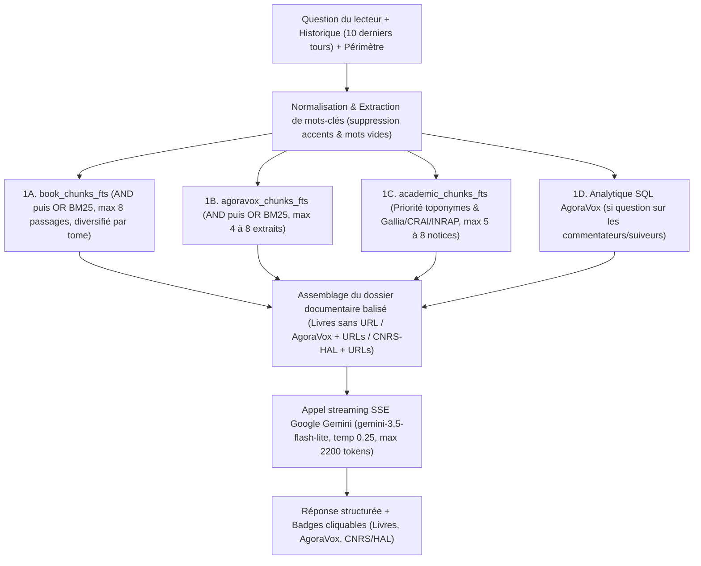

# Rapport d'Audit — Base Documentaire Cloudflare D1 & Fonctionnement de l'Assistant IA

> **Objet** : Audit complet des données indexées sur Cloudflare D1 (`livres_de_jean`), explication de la réponse observée dans la session [`em-511b1s5s0z`](https://pmourey.github.io/Livres-de-Jean/#/ai/share/em-511b1s5s0z), fonctionnement détaillé du moteur RAG / Gemini, usage des connaissances externes et pistes d'enrichissement continu des modèles.

---

## 1. Diagnostic précis de la session `em-511b1s5s0z`

> [!IMPORTANT]
> **Les 740 publications scientifiques et rapports de fouilles archéologiques sont bien présents et opérationnels dans la base Cloudflare D1 (`academic_chunks`).**
> L'absence de sources scientifiques dans la session `em-511b1s5s0z` provient de **deux causes cumulées** :

1. **Le filtre de périmètre de la session était positionné sur `agoravox`** (`Uniquement AgoraVox (articles & commentaires)`) :
   * Métadonnées enregistrées sur `em-511b1s5s0z` : `scope: "agoravox"`, `indexedChunksUsed: 0`, `indexedAgoravoxUsed: 8`, `indexedAcademicUsed: 0`.
   * Or, dans [src/worker.ts](file:///Users/display/antigravity/Éditions-Émile-Mourey---Librairie-Historique/src/worker.ts#L1623), la recherche dans les livres (`book_chunks_fts`) et dans les publications scientifiques (`academic_chunks_fts`) est volontairement désactivée lorsque `sourceScope === 'agoravox'`.
   * Le modèle a donc appliqué loyalement sa règle anti-hallucination : ne recevant que 8 extraits AgoraVox et 0 publication universitaire, il a répondu honnêtement qu'aucune publication *Gallia* / CNRS / INRAP ne figurait dans le dossier transmis.
2. **En question de suivi (message n° 3)**, la requête *« peux-tu citer les références des publications scientifiques contredisant les thèses d'Emile Mourey? »* ne contenait aucun nom de site (`Bibracte`, `Alésia`, `Gergovie`, `Beuvray`, etc.) :
   * Même en périmètre `all`, la recherche FTS5 n'analyse aujourd'hui que les mots-clés du **dernier message** (`question`), sans réinjecter les entités nommées (toponymes) du premier message de la session.
   * **Recommandation immédiate** : repasser le sélecteur **Périmètre** sur **`Toute la base (Ouvrages + AgoraVox + CNRS/HAL)`** (ou **`Uniquement les publications scientifiques (CNRS / HAL / Gallia)`**), et il est facile d'améliorer `src/worker.ts` pour fusionner automatiquement les mots-clés du 1er message lors des questions de suivi.

---

## 2. Inventaire exhaustif des données indexées dans Cloudflare D1

La base Cloudflare D1 (`livres_de_jean`, taille actuelle : **95,24 Mo** sur un plafond de 5 Go) contient **37 047 enregistrements textuels** répartis en **3 corpus isolés**, chacun doté de son propre index plein texte **SQLite FTS5** (ranking BM25).

| Corpus | Table D1 & Index FTS5 | Volume indexé | Origine exacte |
| :--- | :--- | ---: | :--- |
| **Ouvrages d'Émile Mourey** | `book_chunks` / `book_chunks_fts` | **6 937** passages | Fichiers PDF originaux des livres (extraction page par page via `scripts/index-books-to-d1.mjs`) |
| **AgoraVox (Articles & Débats)** | `agoravox_chunks` / `agoravox_chunks_fts` | **29 370** extraits | Archive locale `~/Agoravox` + collecte en direct des 89 articles plus récents sur `agoravox.fr` (`scripts/index-agoravox-to-d1.py`, `scripts/sync-missing-agoravox.py`) |
| **Publications scientifiques & archéologiques** | `academic_chunks` / `academic_chunks_fts` | **740** notices & résumés | API ouverte **CNRS HAL-SHS** (`api.archives-ouvertes.fr`) + synthèses **Persée / *Gallia* 55 / CRAI / INRAP / OpenEdition** (`scripts/index-academic-to-d1.py`) |
| **Total indexé** | **3 tables + 3 index FTS5** | **37 047** entrées | — |

---

### 2.1. Corpus 1 — Ouvrages d'Émile Mourey (`book_chunks` : 6 937 passages)

Chaque passage stocke `book_id`, `book_title`, `tome`, `page_number`, `chapter` et `content` (~900–1 200 caractères par segment).

| Identifiant (`book_id`) | Ouvrage | Tome | Passages indexés | Pages couvertes |
| :--- | :--- | :--- | ---: | ---: |
| `mourey-gergovie-tome-1` | *Histoire de Gergovie* | Tome 1 | 786 | p. 1 à 413 |
| `mourey-bibracte-tome-2-bouclier-eduen` | *Histoire de Bibracte* | Tome 2 : Le Bouclier Éduen | 1 860 | p. 1 à 392 |
| `mourey-bibracte-tome-3-epee-flamboyante` | *Histoire de Bibracte* | Tome 3 : L'Épée Flamboyante | 818 | p. 1 à 399 |
| `mourey-bibracte-tome-4-dieu-rayonnant` | *Histoire de Bibracte* | Tome 4 : Dieu Rayonnant | 700 | p. 1 à 370 |
| `mourey-bibracte-tome-5-dieu-cache` | *Histoire de Bibracte* | Tome 5 : Dieu Caché | 798 | p. 1 à 406 |
| `mourey-gaule-en-heritage` | *La Gaule en héritage* | 1ère partie | 798 | p. 1 à 302 |
| `mourey-christ-tome-1` | *Histoire du Christ* | Tome 1 | 864 | p. 1 à 415 |
| `mourey-mahomet-tome-1` | *Histoire de Mahomet* | Tome 1 | 313 | p. 1 à 101 |
| **Total** | **8 volumes PDF intégraux** | — | **6 937** | **2 798 pages** |

> [!NOTE]
> Les ouvrages complémentaires du catalogue sans PDF complet encore ingéré (*Histoire du Christ Tome 2*, *Histoire de Mahomet Tome 2*, *La Gaule en héritage 2ème partie*) restent couverts via le contexte de repli (`fallbackContext` : synopsis, table des matières, citations clés et 7 dossiers d'études). Leur ingestion PDF directe dans `book_chunks` augmenterait encore la précision page par page.

---

### 2.2. Corpus 2 — AgoraVox (`agoravox_chunks` : 29 370 extraits)

| Type (`source_type`) | Extraits indexés | Articles distincts couverts | Auteurs / Pseudos distincts | Liens directs conservés |
| :--- | ---: | ---: | ---: | :--- |
| `article` (Émile Mourey) | **6 586** | **559** articles | 1 (Émile Mourey) | URL canonique `https://www.agoravox.fr/.../article/...` |
| `comment` (Lecteurs & réponses d'Émile Mourey) | **22 784** | **556** articles | **1 377** intervenants | Ancre exacte `#forum<id>` + profil `/auteur/<slug>` (120 top contributeurs mappés) |

---

### 2.3. Corpus 3 — Publications scientifiques & archéologiques (`academic_chunks` : 740 publications)

#### Répartition par portail scientifique officiel
* **CNRS HAL / HAL-SHS** (`hal.science` / `shs.hal.science`) : **704** publications
* **Archives universitaires françaises partenaires HAL** (`theses.hal.science`, `tel.archives-ouvertes.fr`, `dumas.ccsd.cnrs.fr`, `hal-univ-*`) : **32** publications
* **Persée (CNRS Éditions — *Gallia* 55 & *CRAI*)** : **2** synthèses canoniques de fouilles (Bibracte 1984–1995 ; Alésia 1991–1995)
* **OpenEdition (*Revue archéologique du Centre de la France* / INRAP)** : **1** synthèse de fouilles (Gergovie)
* **Centre archéologique européen du Mont Beuvray (`bibracte.fr`)** : **1** monographie de référence (Goudineau & Peyre)

#### Répartition par thématique et type de document

| Thématique | Articles scientifiques | Ouvrages / Chapitres | Rapports de fouilles | Thèses / HDR | Total |
| :--- | ---: | ---: | ---: | ---: | ---: |
| **Bibracte & Éduens** | 46 | 44 | 64 | 5 | **159** |
| **Alésia & Siège de 52 av. J.-C.** | 96 | 16 | 6 | 12 | **130** |
| **Origines de l'islam, Coran & Tabari** | 65 | 20 | 0 | 10 | **95** |
| **Esséniens, Qumrân & Judéo-christianisme** | 55 | 17 | 0 | 14 | **86** |
| **Table de Peutinger & Voies romaines** | 50 | 20 | 4 | 11 | **85** |
| **Guerre des Gaules & Légions** | 42 | 32 | 1 | 6 | **81** |
| **Gergovie & Arvernes** | 33 | 13 | 3 | 3 | **52** |
| **Bourgogne antique, Autun & Chalon** | 26 | 7 | 6 | 4 | **43** |
| **Art roman bourguignon (Vézelay, Autun, Chalon)** | 6 | 2 | 0 | 1 | **9** |
| **Total** | **419** | **171** | **84** | **66** | **740** |

---

## 3. Méthode utilisée par l'Assistant IA (Architecture RAG Hybride)

L'Assistant IA n'est pas un simple chatbot générique : il fonctionne selon une architecture **RAG (*Retrieval-Augmented Generation*) strictement ancrée** côté Cloudflare Worker ([src/worker.ts](file:///Users/display/antigravity/Éditions-Émile-Mourey---Librairie-Historique/src/worker.ts#L1386-L2223)).

### Étapes techniques détaillées
1. **Extraction des mots-clés** : suppression des accents, de la ponctuation et d'une liste de mots vides (*les, des, emile, mourey, these, article, scientifique...*), conservation des 8 termes discriminants.
2. **Double passe FTS5 BM25 sur chaque corpus autorisé par le périmètre (`sourceScope`)** :
   * Passe 1 (`AND`) : haute précision sur les 2–3 termes principaux (pour les publications scientifiques, priorité donnée aux toponymes `bibracte`, `beuvray`, `alesia`, `gergovie`, `peutinger`, `qumran`, etc., et aux rapports canoniques `gallia-*`, `crai-*`, `inrap-*`).
   * Passe 2 (`OR`) : élargissement par pertinence BM25 si la passe 1 retourne moins de 5 à 10 résultats.
3. **Analytique SQL directe** : pour les questions portant sur la communauté AgoraVox (*suiveurs, commentateurs, contradicteurs*), le Worker exécute un `GROUP BY author_name` temps réel sur les 22 784 commentaires et associe les URLs de profils depuis [agoravoxAuthorProfiles.ts](file:///Users/display/antigravity/Éditions-Émile-Mourey---Librairie-Historique/src/data/agoravoxAuthorProfiles.ts).
4. **Génération contrôlée** : envoi au modèle **`gemini-3.5-flash-lite`** (bascule automatique vers `gemini-3.8-flash` en cas d'indisponibilité) à **température basse (`0.25`)** avec un prompt système imposant la séparation stricte entre ouvrages imprimés, articles/commentaires AgoraVox et publications scientifiques officielles.

---

## 4. Le modèle utilise-t-il des données externes ou ses connaissances d'apprentissage ?

| Source potentielle | Utilisée aujourd'hui ? | Explication précise |
| :--- | :---: | :--- |
| **Navigation web en temps réel (Google Search Grounding)** | **Non** | Le Worker n'active pas l'outil `google_search` de l'API Gemini. L'IA ne va pas lire Internet en direct pendant une réponse. |
| **Base de données Cloudflare D1 (RAG)** | **Oui (source principale)** | 100 % des citations, numéros de pages, URLs AgoraVox et URLs CNRS/HAL/Persée proviennent exclusivement des passages injectés depuis D1. |
| **Connaissances pré-entraînées du LLM (`gemini-3.5-flash-lite`)** | **Bridées volontairement** | Le modèle possède bien des connaissances générales (histoire romaine, archéologie, exégèse), mais la règle n° 1 du prompt système (*« Appuie-toi STRICTEMENT sur les sources fournies. N'invente jamais une citation, un numéro de page ni une URL »*) lui interdit d'inventer des références bibliographiques hors contexte. En pratique, ses connaissances internes ne servent qu'à **comprendre la question, structurer le raisonnement et rédiger en français**. |

> [!TIP]
> **Option activable à la demande** : l'API Gemini permet d'activer nativement **`google_search` (Search Grounding)** en complément de votre base D1. Si vous le souhaitez, l'Assistant IA pourrait interroger en direct **Persée, OpenEdition, HAL, Gallica (BnF) ou INRAP** pour trouver des fouilles récentes non encore présentes dans D1, tout en conservant D1 comme source d'autorité pour les écrits d'Émile Mourey.

---

## 5. Comment enrichir les données et améliorer le modèle à partir de vos corpus et des prompts du site ?

Dans une architecture IA moderne, on distingue **trois leviers complémentaires** d'enrichissement (du plus rentable et fiable au plus lourd) :

### Levier 1 — Enrichissement du corpus RAG & Recherche sémantique (Vectorize) *(Recommandé en priorité)*
1. **Ingérer les PDF complets manquants** dans `book_chunks` (*Histoire du Christ T2*, *Histoire de Mahomet T2*, *La Gaule en héritage 2e partie*).
2. **Indexation plein texte (et non seulement résumés) des rapports archéologiques clés** : les 704 notices HAL actuelles indexent le titre, les auteurs, les mots-clés et le résumé (*abstract*). Pour les 20–30 publications majeures sur Bibracte, Alésia et Gergovie dont le PDF est en accès libre sur HAL (`pdf_url` déjà stocké dans `academic_chunks`), on peut extraire le **texte intégral des conclusions de fouilles** dans D1.
3. **Ajouter la recherche vectorielle (Cloudflare Vectorize + Gemini Embeddings)** en parallèle de FTS5 :
   * Aujourd'hui, FTS5 recherche des **mots exacts**. Si un lecteur demande *« les preuves archéologiques contredisant l'auteur »* sans répéter le mot *« Bibracte »*, FTS5 ne retrouve pas les notices Bibracte.
   * Une recherche hybride **FTS5 + Embeddings vectoriels** comprend le sens conceptuel et retrouve automatiquement les bons passages même avec des synonymes ou des formulations indirectes.
4. **Fusion du contexte de session pour les questions de suivi** : enrichir `src/worker.ts` pour combiner les mots-clés du 1er message de la conversation avec ceux de la question de suivi lors des requêtes FTS5.

### Levier 2 — Boucle d'apprentissage à partir des prompts générés sur le site *(Feedback Loop / Curated Q&A)*
Vous pouvez capitaliser sur les meilleures questions posées par les lecteurs sans ré-entraîner le modèle :
1. **Journalisation anonymisée des requêtes (`ai_query_logs` dans D1)** : enregistrer uniquement la question, le périmètre, le nombre de sources trouvées (`indexedChunksUsed`, `indexedAcademicUsed`), les sources citées et un bouton lecteur 👍 / 👎 (*« Réponse utile / Imprécise »*).
2. **Détection automatique des "trous documentaires"** : toute question ayant renvoyé `0` passage livre ou `0` source scientifique remonte dans votre Back-Office Auteur, vous indiquant exactement quels articles HAL/Persée ou quels extraits de livres ajouter.
3. **Base de fiches de référence validées par l'éditeur (`curated_qa`)** : pour les 30 questions les plus fréquentes (Bibracte/Beuvray, *altero die*, Gorgobina, Gergovie, art roman, Qumrân, Tabari), une réponse synthétique relue et validée par vos soins peut être injectée en priorité dans le contexte RAG.

### Levier 3 — Fine-tuning (Ajustement fin) d'un modèle Gemini sur votre corpus
* **Faisabilité** : Google AI Studio / Vertex AI permet le *Supervised Fine-Tuning* (SFT) à partir de paires `(question, réponse attendue)` extraites de vos livres, articles AgoraVox et sessions partagées validées (format JSONL, typiquement 500 à 2 000 exemples).
* **Limite importante** : le fine-tuning apprend au modèle un **style, un ton et une méthode d'analyse** (ex. toujours structurer en *Thèse Mourey / Débat AgoraVox / État des fouilles*), mais **il ne remplace jamais le RAG pour la fidélité factuelle** (numéros de pages exacts, citations littérales, URLs non hallucinées).
* **Stratégie optimale pour les Éditions Émile Mourey** :
  1. **Court terme (immédiat)** : corriger la recherche FTS5 sur les questions de suivi (réutilisation des toponymes de la session) + bouton d'alerte si le filtre `AgoraVox seul` est actif alors que l'utilisateur demande des sources scientifiques.
  2. **Moyen terme** : compléter les PDF manquants dans D1 + indexer le texte intégral des PDF libres HAL (`pdf_url`) + ajouter la journalisation anonymisée des questions sans résultat.
  3. **Long terme** : activer une recherche hybride vectorielle (**Cloudflare Vectorize**) et/ou le **Google Search Grounding** filtré sur les domaines scientifiques (`hal.science`, `persee.fr`, `openedition.org`, `inrap.fr`).
